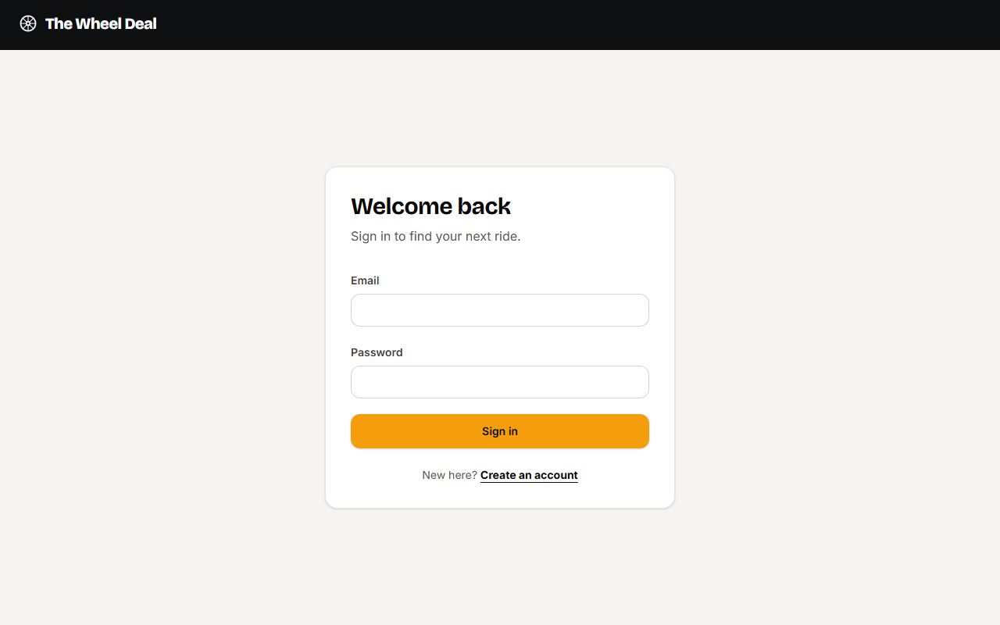
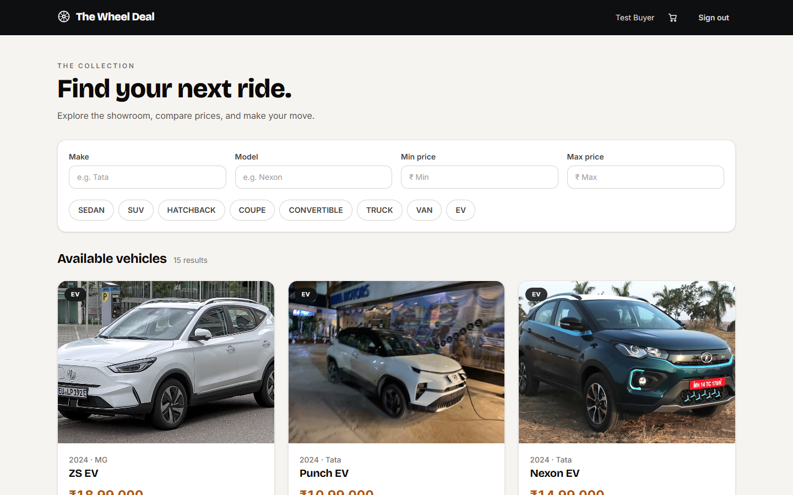
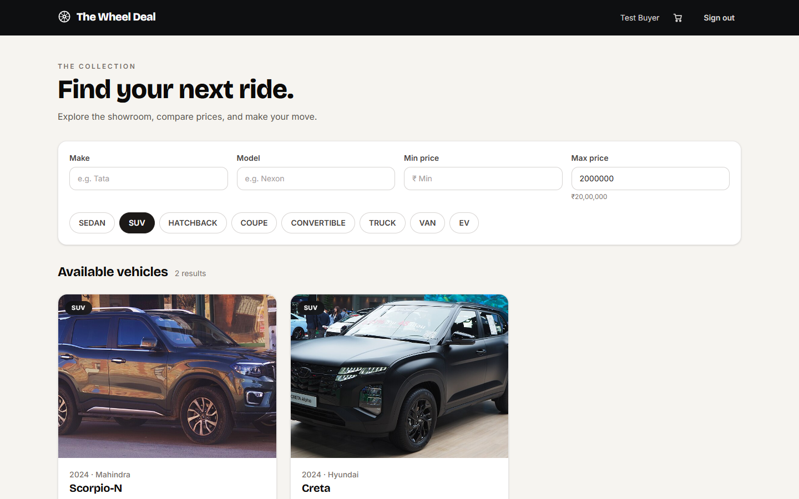
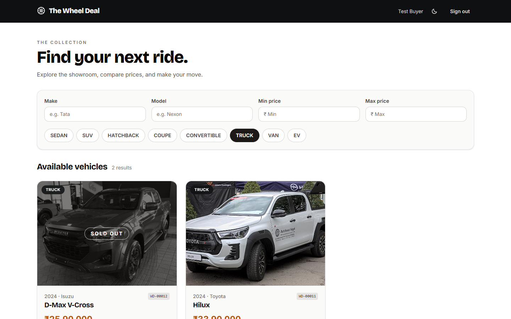
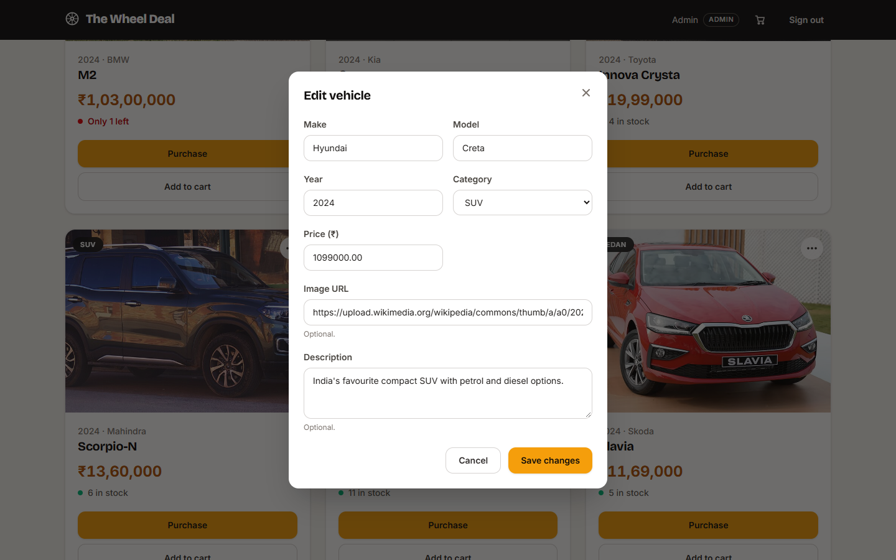
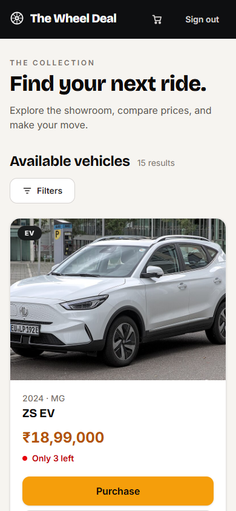

# The Wheel Deal

A car dealership inventory app: a FastAPI + PostgreSQL backend and a React + TypeScript frontend, built as a TDD kata. The backend was written test-first: the git history shows red `test:` commits followed by green `feat:` / `fix:` commits.

## Features

- Register and sign in. Accounts are either `user` or `admin`.
- Browse the inventory as cards. Sold-out cars stay visible with a disabled "Sold out" button; low stock (1 to 3) shows "Only N left".
- Search by make and model (case-insensitive, partial match), category, and a price range. Filters live in the URL, so a filtered view can be bookmarked or shared.
- Any signed-in user can purchase a car. Stock is decremented atomically, so two buyers cannot take the last unit.
- A shopping cart: add cars from the cards, adjust quantities in a cart drawer, and check out everything in one all-or-nothing order. The cart is kept in the browser per user and cleared on sign-out.
- Seeded cars come with photos (Wikimedia Commons, freely licensed, credited in [docs/IMAGE_CREDITS.md](docs/IMAGE_CREDITS.md)); cars without an image show a placeholder.
- Admins can add, edit, delete, and restock vehicles. Admin controls are hidden from normal users in the UI, and every admin endpoint is enforced on the server.
- Prices are in INR and stored as exact decimals.
- Two idempotent scripts: one creates (or promotes) an admin, one seeds sample vehicles.

## Stack

Backend (`backend/`, Python 3.12+)

| Piece | Why |
| --- | --- |
| FastAPI | Typed request and response models, dependency injection for the auth guards, and generated OpenAPI docs at `/docs`. |
| SQLAlchemy 2.0 (sync) | Typed `Mapped[...]` models and explicit `select()` / `update()` statements. Sync keeps the code and the test transaction handling simple (see Design decisions). |
| Alembic | Versioned schema migrations (`alembic/versions`). |
| PostgreSQL 18 + psycopg 3 | Real enum types, CHECK constraints, a case-insensitive unique index, and row locking for atomic stock updates. psycopg 3 is the current driver (`postgresql+psycopg://`). |
| Pydantic v2 + pydantic-settings | Separate Create / Update / Read schemas, and config read from environment variables or `backend/.env`. |
| bcrypt (used directly, not passlib) | Password hashing without an extra wrapper layer; passlib is no longer actively maintained. |
| PyJWT | Signs and verifies HS256 access tokens. |
| pytest, pytest-cov, httpx | Tests run against a real PostgreSQL test database, each test inside a transaction that is rolled back (savepoint). httpx backs FastAPI's `TestClient`. |
| ruff | Linting. |

Frontend (`frontend/`)

| Piece | Why |
| --- | --- |
| React + TypeScript + Vite | Function components and hooks, strict typing, fast dev server and build. |
| Tailwind CSS v4 | Styling through `@tailwindcss/vite`, with no component library. |
| TanStack Query | Server-state caching, loading and error states, and refetching after a purchase or restock. |
| React Router | Routing, protected and admin-only routes, and URL search params for filters. |
| Vitest + React Testing Library | Component and page tests in jsdom. |

## Architecture

```
.
|-- AGENTS.md                 working rules for the AI agent (see below)
|-- docker-compose.yml        PostgreSQL 18 for local use
|-- .env.example              POSTGRES_PASSWORD for Compose
|-- .codex/                   agent config: config.toml, agents/
|-- backend/
|   |-- app/
|   |   |-- main.py           app, CORS, router mounting, exception handler
|   |   |-- api/              routes/ (auth, health, vehicles), dependencies.py, exception_handlers.py
|   |   |-- services/         business rules, raise domain errors, own the commit
|   |   |-- repositories/     all SQL (select / update / delete)
|   |   |-- models/           SQLAlchemy models: User, Vehicle
|   |   |-- schemas/          Pydantic Create / Update / Read schemas
|   |   |-- core/             config.py (pydantic-settings), errors.py (domain errors)
|   |   |-- db/               declarative base, engine and session
|   |   `-- scripts/          create_admin, seed_vehicles
|   |-- alembic/              migrations
|   |-- scripts/              init-test-db.sql
|   |-- tests/                pytest suite, conftest.py with the DB fixtures
|   |-- .env.example
|   `-- requirements.txt, requirements-dev.txt
|-- frontend/
|   `-- src/
|       |-- api/              the only place that talks HTTP (client.ts)
|       |-- auth/             AuthContext, ProtectedRoute
|       |-- components/       FilterBar, VehicleCard, CardMenu, VehicleFormDialog, RestockDialog, ConfirmDialog, Modal
|       |-- hooks/            useVehicleMutations (invalidates the vehicle queries after every write)
|       |-- pages/            Login, Register, Dashboard (admin controls render here for admins)
|       |-- lib/              validation, 422-to-field error mapping, INR formatting
|       `-- test/             Vitest setup
`-- docs/                     TEST_REPORT.md, screenshots/
```

### Backend layering

Requests flow `api/routes -> services -> repositories -> models`.

- Routes are thin: parse the request, declare the auth dependency, call one service function.
- Services hold the rules and the transaction (`commit`). They raise domain errors (`VehicleNotFound`, `OutOfStock`, `EmailAlreadyRegistered`, `InvalidCredentials`, `AuthenticationRequired`, `AdminRequired`) and never import `HTTPException`.
- Repositories contain the SQL and nothing else.
- One exception handler (`api/exception_handlers.py`) maps every `DomainError` to an HTTP status and a `{"detail": "..."}` body. Anything unmapped falls through to 400. A second handler turns database `DataError`s (values PostgreSQL cannot store, such as NUL bytes or numeric overflow) into 422 instead of 500.

### Auth and roles

- `POST /api/auth/login` returns a JWT bearer token (HS256, 60 minute lifetime, claims `sub`, `role`, `exp`). Clients send it as `Authorization: Bearer <token>`.
- The role is never taken from the register body: the schema ignores unknown fields and the repository always creates `user`. Admins are created with the `create_admin` script.
- Authorization reads the user and their role from the database on each request, not from the token's `role` claim, so a role change or a deleted account takes effect immediately.
- Wrong password and unknown email return the identical 401 body (`Invalid credentials`), and an unknown email still runs one bcrypt comparison against a dummy hash, so neither the response nor its timing reveals which emails exist. Passwords over bcrypt's 72-byte limit are a plain 401 at login.
- 401 means "no valid identity" (missing, malformed, or expired token, or the user no longer exists). 403 means "authenticated but not an admin".
- Emails are normalised to lower case and a unique index on `lower(email)` enforces uniqueness. Passwords must be 8 to 72 bytes (bcrypt ignores anything past 72 bytes, so longer ones are rejected instead of silently truncated).

### Frontend structure

- All HTTP goes through `src/api/client.ts`. Components never call `fetch()` directly.
- `AuthContext` holds the token and current user. `ProtectedRoute` redirects visitors without a token to `/login`.
- Admin controls (Add vehicle, and a per-card menu with Edit, Restock and Delete) render on the dashboard only when the current user's role is `admin`. The backend enforces the role regardless. Edit reuses the add modal without the quantity field, Delete asks for confirmation naming the car, and 422 errors are mapped onto the matching form fields.
- Below the `md` breakpoint the filters move into a drawer and the cards go to a single column.
- A 401 from the API clears the stored token and sends the user to `/login`.
- Dashboard filters are read from and written to the URL query string (`make`, `model`, `category`, `min_price`, `max_price`). The TanStack Query key is derived from them.

### AI agent setup (`AGENTS.md`, `.codex/`)

The agent setup checked into this repo targets OpenAI Codex. Each commit's co-author trailer records which tool made it. What the files say:

- `AGENTS.md` is the standing instruction file. It fixes the layout and the backend/frontend conventions described above, and sets the workflow: for each behaviour write the failing test, confirm it fails on an assertion (not an ImportError), commit; then write the minimum code, run the full suite, commit; refactor only on green, in its own commit. Commit prefixes are `test:`, `feat:`/`fix:`, `refactor:`, `chore:`, `docs:`. It also says to ask before adding any dependency that was not named, not to touch git config, push, or rewrite pushed history, and to keep replies short.
- Agent rules in `AGENTS.md`: the main thread does all writing and committing, one TDD cycle at a time, and file-editing agents are never run in parallel (one working tree and one git index, and the red/green order in the history has to stay clean). Test runs go through the `test-runner` agent, repo questions go to the built-in `explorer`, and when a prompt is finished the `reviewer` agent runs and its real findings are fixed in `fix:` / `refactor:` commits.
- `.codex/config.toml` sets the main model (`gpt-6.1-sol`, medium reasoning effort), allows up to 3 concurrent agent threads, sets the default subagent model (`gpt-6-luna`, low effort), and registers the two agents below.
- `.codex/agents/test-runner.toml` (`gpt-6-luna`, low effort): only runs commands and reports. It never edits files or touches git. It runs `pytest -q` in `backend/` and `npx vitest run` in `frontend/`, and answers in a fixed shape: PASS or FAIL, counts, and for each failure the test name, `file:line`, and the assertion in 1 to 3 lines. For coverage runs it reports the total and every file under 90% with its missing line ranges.
- `.codex/agents/reviewer.toml` (`gpt-6.1-sol`, medium effort): read-only, git used only for reading. It checks the commits since the last review against `AGENTS.md`: red commits contain only tests and fail on an assertion; green commits are the minimum change; mutating-endpoint tests assert database state and not only status codes; 401 vs 403 is correct, `password_hash` is never in a response, and money is `Decimal`; routes are thin, domain errors come from services, and services never raise `HTTPException`. It returns at most 8 findings, most serious first, each with `file:line` and a one-line fix, or "no findings".

## Local setup

Prerequisites: Python 3.12 or newer, Node.js and npm, and PostgreSQL (PostgreSQL 18 is what this project was developed on) either installed natively or run through Docker.

Run the backend commands from `backend/`: settings are read from `.env` in the current directory.

### 1. Database

The app needs two databases: `wheeldeal` (the app) and `wheeldeal_test` (the test suite, never the same as the app database). Run the commands in this section from the repo root.

**Option A, Docker Compose.** Create the root `.env` only if it does not exist, set `POSTGRES_PASSWORD` in it, then start PostgreSQL from the repo root.

Windows (PowerShell):

```powershell
if (-not (Test-Path .env)) { Copy-Item .env.example .env }
docker compose up -d
```

macOS / Linux:

```bash
[ -f .env ] || cp .env.example .env
docker compose up -d
```

Compose refuses to start if `POSTGRES_PASSWORD` is not set. It creates `wheeldeal` from `POSTGRES_DB` and mounts `backend/scripts/init-test-db.sql` (`CREATE DATABASE wheeldeal_test;`) into the image's init directory, so both databases exist after the first start. Init scripts only run when the data volume is empty. If you already had a `postgres_data` volume, create the test database by hand:

```bash
docker compose exec postgres psql -U postgres -c "CREATE DATABASE wheeldeal_test;"
```

Port 5432 is published on the host, so stop any native PostgreSQL on that port first.

**Option B, native PostgreSQL.** Create both databases yourself:

```bash
psql -U postgres -c "CREATE DATABASE wheeldeal;"
psql -U postgres -f backend/scripts/init-test-db.sql
```

### 2. Backend

```bash
cd backend
```

Create `backend/.env` only if it does not already exist, then fill in the values.

Windows (PowerShell):

```powershell
if (-not (Test-Path .env)) { Copy-Item .env.example .env }
```

macOS / Linux:

```bash
[ -f .env ] || cp .env.example .env
```

| Variable | Meaning |
| --- | --- |
| `DATABASE_URL` | App database, for example `postgresql+psycopg://postgres:<password>@localhost:5432/wheeldeal`. Use the same password as `POSTGRES_PASSWORD` if you use Compose, and URL-encode special characters. |
| `TEST_DATABASE_URL` | Test database. Must be PostgreSQL, the database must be named `wheeldeal_test`, and it must differ from `DATABASE_URL` (the test fixtures refuse to run otherwise). |
| `JWT_SECRET` | Secret used to sign tokens. Use a long random value, for example `python -c "import secrets; print(secrets.token_urlsafe(48))"`. |
| `CORS_ORIGINS` | Comma-separated allowed browser origins. Defaults to `http://localhost:5173`. |

Create a virtual environment (Python 3.12+), activate it, and install dependencies.

Windows (PowerShell):

```powershell
python -m venv .venv
.venv\Scripts\Activate.ps1
```

macOS / Linux:

```bash
python -m venv .venv
source .venv/bin/activate
```

If PowerShell blocks the activation script, run `Set-ExecutionPolicy -Scope Process -ExecutionPolicy RemoteSigned` in that window first.

```bash
pip install -r requirements-dev.txt
alembic upgrade head
```

Create an admin account. The script reads `ADMIN_EMAIL`, `ADMIN_PASSWORD`, and optionally `ADMIN_FULL_NAME` from the environment. It is idempotent: it creates the account, or promotes it if the email already exists.

Windows (PowerShell):

```powershell
$env:ADMIN_EMAIL = "admin@example.com"
$env:ADMIN_PASSWORD = "<choose-a-password>"
$env:ADMIN_FULL_NAME = "Site Admin"   # optional
python -m app.scripts.create_admin
Remove-Item Env:ADMIN_PASSWORD
```

macOS / Linux:

```bash
ADMIN_EMAIL=admin@example.com ADMIN_PASSWORD='<choose-a-password>' ADMIN_FULL_NAME='Site Admin' \
  python -m app.scripts.create_admin
```

Seed sample data (about 15 cars across all categories, INR prices, two of them sold out, each with a Wikimedia Commons photo). It is idempotent, so re-running it does not duplicate cars; it only fills in a photo for a seeded car whose `image_url` is empty.

```bash
python -m app.scripts.seed_vehicles
```

Start the API:

```bash
uvicorn app.main:app --reload --port 8000
```

The API is now at `http://localhost:8000`, interactive docs at `http://localhost:8000/docs`, and a health check at `http://localhost:8000/api/health`.

### 3. Frontend

In a second terminal, from the repo root:

```bash
cd frontend
npm install
```

Create `frontend/.env` only if it does not exist (it contains `VITE_API_URL=http://localhost:8000`).

Windows (PowerShell):

```powershell
if (-not (Test-Path .env)) { Copy-Item .env.example .env }
```

macOS / Linux:

```bash
[ -f .env ] || cp .env.example .env
```

```bash
npm run dev
```

Open `http://localhost:5173`. The browser origin must be listed in the backend's `CORS_ORIGINS`; if you open the app as `http://127.0.0.1:5173` instead, add that origin there.

## Deployment

`compose.prod.yml` runs the whole app as three containers: PostgreSQL 18, the FastAPI backend (it runs `alembic upgrade head` on start), and nginx serving the production React build and proxying `/api` to the backend. Only nginx is published, on `127.0.0.1:${WEB_PORT}` (default 8095), so a tunnel or reverse proxy in front provides the public hostname and HTTPS. The live site uses a Cloudflare Tunnel public hostname pointing at `http://localhost:8095`.

```bash
git clone https://github.com/ShagunJajodia/The-Wheel-Deal-.git && cd The-Wheel-Deal-
cp .env.prod.example .env.prod   # then set PUBLIC_URL and generate secrets with: openssl rand -hex 32
docker compose -f compose.prod.yml --env-file .env.prod up -d --build
docker compose -f compose.prod.yml --env-file .env.prod exec -e ADMIN_EMAIL=you@example.com -e ADMIN_PASSWORD='<password>' api python -m app.scripts.create_admin
docker compose -f compose.prod.yml --env-file .env.prod exec api python -m app.scripts.seed_vehicles
```

To update: `git pull`, then the same `up -d --build`.

## API

Base path `/api`. "user" means any signed-in user (admins included); protected endpoints need `Authorization: Bearer <token>`. Errors have the body `{"detail": "..."}`, except 422, where `detail` is the list FastAPI produces for validation failures.

| Method | Path | Auth | Success | Errors |
| --- | --- | --- | --- | --- |
| GET | `/api/health` | public | 200 `{"status": "ok"}` | none |
| POST | `/api/auth/register` | public | 201 user (`id`, `email`, `full_name`, `role`) | 409 email already registered (case-insensitive); 422 invalid email, empty name, password under 8 characters or over 72 bytes |
| POST | `/api/auth/login` | public | 200 `{"access_token", "token_type": "bearer"}` | 401 invalid credentials (same response for unknown email and wrong password); 422 malformed body |
| GET | `/api/auth/me` | user | 200 current user | 401 |
| POST | `/api/vehicles` | admin | 201 vehicle | 401; 403; 422 invalid category, price, or quantity |
| GET | `/api/vehicles` | user | 200 list of vehicles, newest first, sold-out included | 401 |
| GET | `/api/vehicles/search` | user | 200 list of vehicles. Query: `make`, `model` (case-insensitive substring; `%` and `_` match literally), `category` (exact), `min_price`, `max_price` (inclusive) | 401; 422 unknown category, negative price, or `min_price` greater than `max_price` |
| GET | `/api/vehicles/{id}` | user | 200 vehicle | 401; 404; 422 non-integer or out-of-range id |
| PUT | `/api/vehicles/{id}` | admin | 200 updated vehicle. Partial update: send only the fields to change | 401; 403; 404; 422 empty body, unknown field (including `quantity`), explicit `null` for a required field, or an out-of-range value |
| DELETE | `/api/vehicles/{id}` | admin | 204 no content | 401; 403; 404 |
| POST | `/api/vehicles/{id}/purchase` | user | 200 updated vehicle. Optional body `{"quantity": n}` with `n >= 1`, default 1 | 401; 404; 409 not enough stock; 422 invalid quantity |
| POST | `/api/cart/checkout` | user | 200 `{"items": [vehicle, ...]}`. Body `{"items": [{"vehicle_id", "quantity"}]}`, 1 to 20 items, quantity `>= 1` | 401; 404 `Vehicle <id> not found`; 409 `Not enough stock for <year> <make> <model>` (nothing is bought); 422 empty, duplicate ids, or more than 20 items |
| POST | `/api/vehicles/{id}/restock` | admin | 200 updated vehicle. Body `{"quantity": n}` required, `n >= 1` | 401; 403; 404; 422 |

A vehicle is `id`, `make`, `model`, `year`, `category`, `price`, `quantity`, `image_url`, `description`, `created_at`, `updated_at`. `price` is a JSON string such as `"1250000.00"`. `category` is one of `sedan`, `suv`, `hatchback`, `coupe`, `convertible`, `truck`, `van`, `ev`.

## Design decisions

- **Vehicle writes are admin-only.** `POST`, `PUT`, and `DELETE` on vehicles require the admin role. Browsing and purchasing need any signed-in user. Nothing in the inventory API is public.
- **No `quantity` in `PUT`.** Stock only changes through `purchase` and `restock`. The update schema forbids extra fields, so a `quantity` in the body is a 422. Otherwise an admin saving a stale edit form could overwrite a sale that happened in the meantime.
- **Atomic purchase.** A read-then-write ("load the car, check `quantity > 0`, save `quantity - 1`") races: two requests can both read 1, both pass the check, and both write 0, selling one car twice. Purchase is instead a single statement, `UPDATE vehicles SET quantity = quantity - :n WHERE id = :id AND quantity >= :n RETURNING ...`. PostgreSQL locks the row, and a competing update re-checks the `WHERE` clause after the lock is released, so exactly one of two buyers of the last unit gets a row back and the other gets 409. If no row comes back, a second lookup decides between 404 (no such car) and 409 (not enough stock). Restock is an atomic increment for the same reason. The `quantity >= 0` CHECK constraint on the table is a second line of defence.
- **Cart checkout is all-or-nothing.** The cart itself lives in the browser (no server-side cart table to keep in sync), and `POST /api/cart/checkout` runs every line's conditional decrement in one transaction, in ascending vehicle id order so two concurrent checkouts lock rows in the same order and cannot deadlock. If any line is short or missing, the whole transaction rolls back and the response names the car, so a customer never ends up with half an order.
- **`/search` is registered before `/{id}`.** Routes match in registration order; if `/{vehicle_id}` came first, `GET /api/vehicles/search` would try to parse `search` as an integer id and return 422. A test pins the order.
- **Filters live in the URL.** Make, model, category, and price bounds are query parameters of the dashboard, not component state. Views survive a refresh, work with back/forward, and can be shared. Make and model are debounced by 300 ms before they are written to the URL.
- **Token in `localStorage`.** The SPA and the API are separate origins, and a bearer header avoids cross-site cookie configuration (`SameSite=None`, `Secure`, CSRF protection). The cost is that any XSS bug can read the token. Mitigations: React escapes rendered values, the app has no `dangerouslySetInnerHTML`, tokens expire after 60 minutes, and a 401 clears the stored token. An `httpOnly`, secure cookie would remove the token from JavaScript's reach, but needs credentialed CORS and CSRF protection, or serving the SPA and API from one site.
- **Money is INR, `Decimal`, never `float`.** `Numeric(10, 2)` in PostgreSQL, `Decimal` in Python, and a JSON string on the wire so no float rounding happens in between. The frontend keeps the string and only converts for display with `Intl.NumberFormat("en-IN", { currency: "INR" })`. Prices must be greater than 0.
- **`category` is an enum.** One set of values is shared by a PostgreSQL enum type, a Python `Enum`, and request validation, so a bad category is a 422 and never reaches the database. The frontend repeats the list in `src/api/client.ts`, so a new category needs a migration plus an update there.
- **Sync SQLAlchemy.** The workload is short, database-bound CRUD. FastAPI runs `def` endpoints in a threadpool, so sync code does not block the event loop, and it avoids async-session pitfalls and keeps the per-test transaction fixture simple.
- **Real PostgreSQL in tests.** The behaviour that matters lives in the database: enum types, CHECK constraints, the `lower(email)` unique index, and `UPDATE ... RETURNING`. SQLite would not give the same answers, so the tests use `wheeldeal_test` on PostgreSQL.
- **Login does not reveal which emails exist, but register does.** Login answers wrong-password and unknown-email identically. Registering a taken email returns 409, which does reveal that the account exists. That is a deliberate usability tradeoff.

## Running tests

Backend (from `backend/`, venv active, PostgreSQL running, `wheeldeal_test` created):

```bash
python -m pytest -q
python -m pytest --cov=app --cov-report=term-missing
ruff check .
```

`python -m pytest` is used so the current directory (`backend/`) is on the import path; there is no `pytest.ini` or `pyproject.toml` that does it for a bare `pytest`.

How the test database works (`backend/tests/conftest.py`):

- The `wheeldeal_test` database is created by `scripts/init-test-db.sql` (Compose does it on first start; with native PostgreSQL you run it yourself). Alembic is not used for tests.
- At the start of the test session the tables are created with `metadata.create_all`; at the end they are dropped. The fixtures refuse to run unless `TEST_DATABASE_URL` is a PostgreSQL URL for a database named `wheeldeal_test` that differs from `DATABASE_URL`.
- Each test runs inside an outer transaction with the session in savepoint mode (`join_transaction_mode="create_savepoint"`). The code under test can `commit()`, and the outer transaction is rolled back after the test, so tests do not see each other's rows.
- The `client` fixture overrides `get_db` with that session. `user_token` registers and logs in a regular user, and `admin_token` inserts an admin directly and logs in.

Frontend (from `frontend/`):

```bash
npm test           # vitest run
npm run build      # tsc --noEmit, then vite build
```

Latest results, coverage, and notes: [docs/TEST_REPORT.md](docs/TEST_REPORT.md).

## Screenshots

Sign in:



Dashboard with the full inventory:



Filtered results (filters are in the URL):



A sold-out vehicle:



Admin add/edit modal:



Mobile layout:



## My AI Usage

TODO
